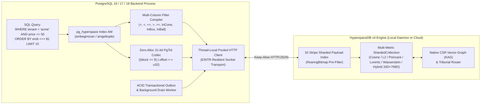

<div align="center">

# `pg_hyperspace`

**The Universal Multi-Metric Vector, Hyperbolic Manifold & Native KAG GraphRAG Extension for PostgreSQL (16 / 17 / 18)**

[](LICENSE)
[](Cargo.toml)
[](pg_hyperspace/Cargo.toml)
[](https://yar.ink)

**One `pgvector` column. Seven geometric metrics (`cosine`, `l2`, `dot`, `poincare`, `lorentz`, `wasserstein`, `hybrid`). Multi-column range pre-filtering. Sub-millisecond KAG graph traversals. Zero-hallucination Tribunal verification.**

</div>

---

## Why `pg_hyperspace`? (The Post-`pgvector` Era)

PostgreSQL is the world's most trusted transactional database, and `pgvector` made it easy to store embeddings alongside relational rows. Yet as soon as teams scale past toy RAG prototypes into production multi-tenant systems, hierarchical taxonomies, or agentic reasoning, **`pgvector` hits three fundamental architectural walls**:

### Wall #1: The Selective Filter Cliff (`WHERE tenant_id = 'acme' AND price <= 50`)
In `pgvector`, HNSW graphs are **metadata-blind**. When you run `SELECT ... WHERE tenant_id = 'acme' ORDER BY embedding <=> $1 LIMIT 10`, `pgvector` performs **post-filtering**: it walks the global HNSW graph to find top candidates across the *entire table* and discards rows that fail the `WHERE` clause. When a tenant owns 0.5% of the table, 99.5% of visited nodes are thrown away — causing latency to spike by **10–50×** or returning fewer than `LIMIT` rows.

Even newer extensions like `pg_pinecone` only allow **a single filter column** and **only equality (`=`)**.

**How `pg_hyperspace` solves it:**
`pg_hyperspace` supports **multi-column composite indexes** (`CREATE INDEX ON items USING hyperspace (embedding, tenant_id, price, category)`) and pushes **all 5 B-tree comparison strategies (`<`, `<=`, `=`, `>=`, `>`)** plus spatial/hyperbolic region predicates (`InCone`, `InBox`, `InBall`) directly into HyperspaceDB's **32-Stripe Sharded RoaringBitmap Payload Index** for **Zero-Latency Pre-Filtering** *before* distance evaluation.

### Wall #2: The Flat-Earth Trap (Euclidean-Only Metrics)
`pgvector` (and `pg_pinecone`) assume all embeddings live in flat Euclidean space (`l2`, `cosine`, `ip`). By **Gromov's $\delta$-Hyperbolicity Theorem**, embedding a tree, taxonomy, code AST, organizational chart, or causal DAG into flat Euclidean space causes exponential volume distortion — leaf nodes crowd together and parent-child hierarchies collapse.

**How `pg_hyperspace` solves it:**
`pg_hyperspace` brings **7 native Riemannian, Optimal Transport, and Product-Manifold metrics** directly to standard `pgvector` columns:
1. **Cosine (`<=>`, `vector_cosine_ops`)** — Normalized semantic embeddings.
2. **Euclidean $L_2$ (`<->`, `vector_l2_ops`)** — Dense spatial embeddings.
3. **Inner Product (`<#>`, `vector_ip_ops`)** — Maximum Inner Product Search (MIPS).
4. **Poincaré Ball (`<~>`, `vector_poincare_ops`)** — Hyperbolic unit ball $\mathbb{B}^d$ with exponential volume growth for trees and taxonomies.
5. **Lorentz Hyperboloid (`<@>`, `vector_lorentz_ops`)** — Minkowski spacetime sheet $\mathbb{H}^d \subset \mathbb{R}^{1,d}$ enabling **Causal Light-Cone Entailment (`in_lorentz_cone`)**.
6. **1D Wasserstein Optimal Transport (`<|>`, `vector_wasserstein_ops`)** — Earth Mover's Distance ($W_1$) over probability distributions and uncertainty histograms.
7. **Product-Manifold Hybrid (`<+>`, `vector_hybrid_ops`)** — Combines a **33D Lorentz Hyperboloid Head ($\mathbb{H}^{32}$)** for exact structural hierarchy with a **$(D - 33)$-dimensional Euclidean Semantic Tail ($\mathbb{R}^{D-33}$)** (such as 801D `AsymmetricHybrid801`), preserving `f32` precision on the Minkowski time coordinate while quantizing the semantic tail.

### Wall #3: Slow `WITH RECURSIVE` Graph Joins & RAM Exhaustion
In PostgreSQL, multi-hop graph traversal over knowledge graphs requires `WITH RECURSIVE` CTEs and random B-tree index joins that degrade to hundreds of milliseconds at depth 3+. Meanwhile, `pgvector` HNSW indexes must fit in `shared_buffers` or suffer ribuan random page hops per query.

**How `pg_hyperspace` solves it:**
- **Native Vector-Graph (KAG) in SQL:** `hyperspace.link()`, `hyperspace.induce_graph()`, and `hyperspace.reachable_nodes()` execute multi-hop BFS traversals over HyperspaceDB's 12-byte packed **Compressed Sparse Row (CSR) Graph** in **< 1 ms**, co-located in the same CPU cache line as the vectors.
- **SuperKMeans + Matryoshka (MRL) Cascade + Page-Aligned Direct I/O:** Keeps compact 64D/128D heads and 1-bit/4-bit TurboQuant codes in RAM while fetching full-precision tails from NVMe via hardware-aligned `O_DIRECT` / `F_NOCACHE`, cutting RAM usage by **up to 90%** with **99.95% Recall@10**.

---

## Feature Matrix: `pgvector` vs `pg_pinecone` vs `pg_hyperspace`

| Capability | `pgvector` | `pg_pinecone` | **`pg_hyperspace`** |
| :--- | :--- | :--- | :--- |
| **Supported Vector Metrics** | `l2`, `cosine`, `ip` | `l2`, `cosine`, `ip` | **`cosine`, `l2`, `dot`, `poincare`, `lorentz`, `wasserstein`, `hybrid`** |
| **Product-Manifold Hybrid Vectors** | No | No | **`vector_hybrid_ops` (`<+>`): 33D Lorentz Head + Euclidean Semantic Tail** |
| **Hyperbolic Light-Cones** | No | No | **`hyperspace.in_lorentz_cone()` & `InCone` index pushdown** |
| **Optimal Transport ($W_1$)** | No | No | **`vector_wasserstein_ops` (`<\|>`) & `hyperspace.wasserstein_distance()`** |
| **Composite Filter Columns** | None (post-filter cliff) | Max **1** column | **Unlimited (`N` columns) in composite index** |
| **Pushed Filter Operators** | None | Equality (`=`) only | **All 5 B-tree strategies (`<`, `<=`, `=`, `>=`, `>`) + `InBox` / `InBall` / `InCone`** |
| **Native GraphRAG (KAG) in SQL** | Slow `WITH RECURSIVE` | No | **`hyperspace.link()`, `induce_graph()`, `reachable_nodes()` (CSR BFS)** |
| **Hallucination Guardrail** | No | No | **`hyperspace.verify_generation()` (Tribunal Geodesic + Cone Router)** |
| **Tuple ID (`ctid`) Encoding** | Native `ItemPointer` | Heap `String` (`"block:offset"`) | **Zero-alloc 31-bit `(block << 9) \| offset` `u32` codec (`PgTid`)** |
| **TOAST Memory Safety** | C native | **Leaks `pg_detoast_datum` buffer** | **Zero-leak: immediate `pg_sys::pfree` on detoasted buffers** |
| **Backend HTTP Connection Pool** | N/A | Recreates `ureq::Agent` per query | **`thread_local!` cached `Arc<Client>` + scan-cached `TableRegistryRow`** |
| **100% Local Self-Hosted Mode** | Yes | Native mode only (limited) | **Yes (`hyperspace-server` local daemon or Cloud cluster)** |

---

## Architecture Overview



---

## Engineering Improvements Over `pg_pinecone`

During our line-by-line engineering audit of `pg_pinecone`, we identified and resolved four critical memory and performance bottlenecks:

1. **Eliminated TOAST Memory Leaks (`pg_hyperspace/src/vector_datum.rs`):**
   In `pg_pinecone` (`src/am.rs:parse_vector`), `pg_sys::pg_detoast_datum` is called without freeing the newly allocated `varlena` buffer when a `vector(1536)` datum is compressed or stored out-of-line in TOAST, leaking 3–12 KB per row into `CurrentMemoryContext` during index builds and scans. `pg_hyperspace` checks `if detoasted != raw_ptr` and immediately invokes `pg_sys::pfree(detoasted.cast())` after reading the unaligned coordinates.
2. **Eliminated Per-Query SPI Lookups & HTTP Agent Re-Allocation (`pg_hyperspace/src/backend.rs`, `am.rs`):**
   `pg_pinecone` queries its catalog table via SPI and constructs a brand-new `ureq::Agent` (TLS context, DNS resolver, connection pool) on every single query. `pg_hyperspace` caches `Arc<Client>` inside a `thread_local!` slot keyed by `Config` and caches `TableRegistryRow` inside `HyperspaceScanState` at `ambeginscan`.
3. **Zero-Allocation 31-Bit `ItemPointer` <-> `u32` Bit-Packing (`pg_hyperspace-client/src/tid.rs`):**
   Instead of heap-allocating `"block:offset"` strings for every tuple, `PgTid` packs `(block, offset)` into a single 31-bit `u32` (`((block & 0x003F_FFFF) << 9) | (offset & 0x01FF)`) in $O(1)$ time with zero allocations for tables up to 32 GiB, seamlessly falling back to FNV-1a + `_pg_tid` metadata for multi-terabyte tables.
4. **Composite Multi-Column & Range Pushdown (`pg_hyperspace/src/am_filter.rs`):**
   Supports arbitrary composite filter columns (`CREATE INDEX ON t USING hyperspace (emb, col1, col2, col3)`) and all 5 B-tree comparison strategies (`<`, `<=`, `=`, `>=`, `>`), automatically populating HyperspaceDB's `__hs_typed__<col>` numeric index entries on `INSERT`.

---

## Distance Operators & Operator Classes

| Operator Class | Operator | Metric | Manifold / Geometry | Typical Use Case |
| :--- | :---: | :--- | :--- | :--- |
| `vector_cosine_ops` | `<=>` | `cosine` | Unit Sphere $\mathbb{S}^{D-1}$ | Standard text & multimodal embeddings |
| `vector_l2_ops` | `<->` | `l2` | Euclidean $\mathbb{R}^D$ | Dense spatial & image embeddings |
| `vector_ip_ops` | `<#>` | `dot` | Dual Space $(\mathbb{R}^D)^*$ | Maximum Inner Product Search (MIPS) |
| `vector_poincare_ops` | `<~>` | `poincare` | Poincaré Ball $\mathbb{B}^D$ | Taxonomies, trees, category hierarchies |
| `vector_lorentz_ops` | `<@>` | `lorentz` | Minkowski Hyperboloid $\mathbb{H}^{D-1}$ | Causal DAGs, light-cone entailment (`InCone`) |
| `vector_wasserstein_ops` | `<\|>` | `wasserstein` | Probability Simplex $\Delta^{D-1}$ | 1D Optimal Transport ($W_1$) over distributions |
| `vector_hybrid_ops` | `<+>` | `hybrid` | Product Manifold $\mathbb{H}^{32} \times \mathbb{R}^{D-33}$ | Ontology + semantics (33D Lorentz Head + Euclidean Tail) |

---

## SQL Tour

### 1. Setup & Multi-Column Composite Indexing

```sql
CREATE EXTENSION IF NOT EXISTS vector;
CREATE EXTENSION IF NOT EXISTS pg_hyperspace;

-- Configure your local hyperspace-server daemon or remote HyperspaceDB Cloud cluster
SET hyperspace.endpoint_url = 'http://127.0.0.1:50050';
SET hyperspace.api_key = 'I_LOVE_HYPERSPACEDB';

CREATE TABLE documents (
    id          bigserial PRIMARY KEY,
    tenant_id   text NOT NULL,
    department  text NOT NULL,
    priority    float8 NOT NULL,
    embedding   vector(768) NOT NULL,
    lorentz_emb vector(33) NOT NULL,
    hybrid_emb  vector(801) NOT NULL
);

-- 1. Cosine index with 3 filter columns (supports =, <, <=, >, >= pre-filtering!)
CREATE INDEX idx_docs_cosine ON documents
    USING hyperspace (embedding vector_cosine_ops, tenant_id, department, priority);

-- 2. 33D Lorentz Hyperboloid index for causal light-cone queries
CREATE INDEX idx_docs_lorentz ON documents
    USING hyperspace (lorentz_emb vector_lorentz_ops, tenant_id);

-- 3. 801D Product-Manifold Hybrid index (33D Lorentz Head + 768D Euclidean Tail)
CREATE INDEX idx_docs_hybrid ON documents
    USING hyperspace (hybrid_emb vector_hybrid_ops, tenant_id, priority);
```

### 2. Multi-Column Range Pre-Filtering & Product-Manifold Hybrid Search

```sql
-- Equality (tenant_id, department) + Numeric Range (priority >= 2.0 AND priority <= 8.5)
-- are evaluated in HyperspaceDB's 32-Stripe Sharded Payload Index prior to distance scoring:
SELECT id, tenant_id, priority
FROM documents
WHERE tenant_id = 'acme'
  AND department = 'legal'
  AND priority >= 2.0 AND priority <= 8.5
ORDER BY embedding <=> '[0.01, -0.02, ...]'::vector
LIMIT 10;

-- Product-Manifold Hybrid Search (<+>) combining 33D Lorentz hierarchy + 768D semantics:
SET hyperspace.component_weights = '{"lorentz": 0.65, "euclidean": 0.35}';

SELECT id, tenant_id
FROM documents
WHERE tenant_id = 'acme' AND priority >= 5.0
ORDER BY hybrid_emb <+> '[1.048, 0.1, 0.2, ...]'::vector
LIMIT 10;
```

### 3. Composing & Inspecting Product-Manifold Hybrid Vectors in SQL

```sql
-- Lift a 32D hierarchy vector onto the 33D Lorentz hyperboloid sheet (u_0 = sqrt(1 + ||x||^2))
-- and concatenate a semantic tail to form a valid Product-Manifold Hybrid vector:
SELECT hyperspace.compose_hybrid(
    ARRAY[0.12, -0.05, 0.31],           -- hierarchical spatial coordinates (padded/lifted to 33D Lorentz head)
    ARRAY[0.04, 0.88, -0.19, 0.42]      -- Euclidean semantic tail
) AS hybrid_vec;

-- Compute weighted Product-Manifold Hybrid distance directly in SQL:
SELECT hyperspace.hybrid_distance(
    hyperspace.compose_hybrid(ARRAY[0.1, 0.2], ARRAY[1.0, 0.0, 0.0, 0.0]),
    hyperspace.compose_hybrid(ARRAY[0.2, 0.4], ARRAY[0.0, 1.0, 0.0, 0.0]),
    lorentz_weight => 1.0,
    euclidean_weight => 0.5
);

-- Extract the 33D Lorentz head to test causal light-cone entailment on a hybrid vector:
SELECT hyperspace.in_lorentz_cone(
    hyperspace.hybrid_lorentz_head(parent_hybrid_vec),
    hyperspace.hybrid_lorentz_head(child_hybrid_vec),
    max_radius => 1.8
);
```

### 4. Non-Euclidean Geodesic Distances & Spatial Predicates

```sql
SELECT
    hyperspace.poincare_distance(ARRAY[0.1, 0.2], ARRAY[0.2, 0.3]) AS d_poincare,
    hyperspace.lorentz_distance(
        hyperspace.lift_to_lorentz(ARRAY[0.1, 0.2]),
        hyperspace.lift_to_lorentz(ARRAY[0.2, 0.4])
    ) AS d_lorentz,
    hyperspace.wasserstein_distance(ARRAY[0.1, 0.7, 0.2], ARRAY[0.2, 0.3, 0.5]) AS d_w1,
    hyperspace.in_box(ARRAY[0.0, 0.0], ARRAY[1.0, 1.0], ARRAY[0.4, 0.6]) AS in_aabb,
    hyperspace.in_ball(ARRAY[0.0, 0.0], 1.0, ARRAY[0.6, 0.8]) AS in_sphere;
```

### 5. Native Vector-Graph (KAG) — Replacing `WITH RECURSIVE`

```sql
-- Create directed labeled edges in HyperspaceDB's CSR Graph
SELECT hyperspace.link('documents', 1001, 1002, 'CITES', 1.0);
SELECT hyperspace.link('documents', 1002, 1005, 'DEPENDS_ON', 0.9);

-- Induce thousands of edges declaratively from metadata rules
SELECT hyperspace.induce_graph(
    'documents',
    '[{"rule":"path_hierarchy","source_field":"section_path","relation":"PARENT_OF","weight":1.0}]'::jsonb
);

-- Sub-millisecond multi-hop BFS traversal directly inside a SQL WHERE clause:
SELECT id, tenant_id, priority
FROM documents
WHERE id = ANY(hyperspace.reachable_nodes('documents', 1001, max_depth => 3, max_nodes => 256));
```

### 6. Tribunal Router (Geometric Hallucination Detection in SQL)

```sql
SELECT hyperspace.verify_generation(
    'documents',
    'All Class-A regulatory filings must be archived for 7 years.',
    ARRAY['doc_1001', 'doc_1002'],
    max_distance_threshold => 1.15,
    check_geodesic => true
);
```

---

## Configuration Reference (PostgreSQL GUCs)

| GUC Parameter | Type | Default | Description |
| :--- | :--- | :---: | :--- |
| `hyperspace.endpoint_url` | `string` | `'http://127.0.0.1:50050'` | Base URL of the local `hyperspace-server` or HyperspaceDB Cloud cluster. |
| `hyperspace.api_key` | `string` | `''` | API key for authenticating with HyperspaceDB (`SUPERUSER` only). |
| `hyperspace.user_id` | `string` | `''` | Optional tenant namespace header (`x-hyperspace-user-id`). |
| `hyperspace.sync_mode` | `enum` | `'direct'` | `'direct'` (immediate lock-free WriteBuffer) or `'async'` (transactional outbox). |
| `hyperspace.iterative_scan` | `enum` | `'auto'` | `'auto'`, `'off'`, `'relaxed_order'`, or `'strict_order'` when growing `top_k`. |
| `hyperspace.am_enabled` | `bool` | `true` | Planner switch for `USING hyperspace` index scans. |
| `hyperspace.am_min_topk` | `int` | `100` | Initial `top_k` requested on the first batch of an index scan. |
| `hyperspace.am_max_topk` | `int` | `10000` | Maximum `top_k` an iterative scan may grow to. |
| `hyperspace.mrl_dimension` | `int` | `0` | Optional Matryoshka (MRL) fast-tier cutoff dimension (`0` = disabled). |
| `hyperspace.use_wasserstein` | `bool` | `false` | Enable 1D Wasserstein Optimal Transport reranking on any search. |
| `hyperspace.query_filters` | `string` | `''` | Session JSON array of spatial/geometric filters (`in_cone`, `in_box`, `in_ball`, `range`). |
| `hyperspace.component_weights` | `string` | `''` | Session JSON map of hybrid component weights (`{"lorentz": 0.7, "euclidean": 0.3}`). |
| `hyperspace.timeout_ms` | `int` | `5000` | HTTP request timeout in milliseconds. |
| `hyperspace.max_retries` | `int` | `3` | Retry count for transient network or `502`/`503`/`429` responses. |
| `hyperspace.worker_enabled` | `bool` | `true` | Enables the background outbox drain worker (`shared_preload_libraries`). |
| `hyperspace.worker_naptime_ms` | `int` | `1000` | Poll interval in milliseconds for the background worker. |

---

## Installation & Building

### Option 1: Docker (PostgreSQL 17 + `pgvector` + `pg_hyperspace`)

```bash
docker build -t pg_hyperspace:pg17 .
docker run -d --name pg-hyperspace \
  -p 5432:5432 \
  -e POSTGRES_PASSWORD=postgres \
  pg_hyperspace:pg17
```

### Option 2: Pure-SQL Kernel for Existing Docker / Alpine Containers

If you are running a pre-built `postgres:16-alpine` or managed container without a C/Rust compiler inside the image, install the schema-compatible SQL kernel immediately:

```bash
docker exec -i <your-postgres-container> psql -U postgres -d <your-db> < sql/pg_hyperspace_docker_install.sql
```

### Option 3: Build from Source with `cargo-pgrx`

```bash
cargo install --locked cargo-pgrx --version 0.19.3
cargo pgrx init --pg17=$(which pg_config)
cargo pgrx install -p pg_hyperspace --release
```

---

## License

Licensed under the [MIT License](LICENSE). Copyright (c) 2026 YARlabs.
